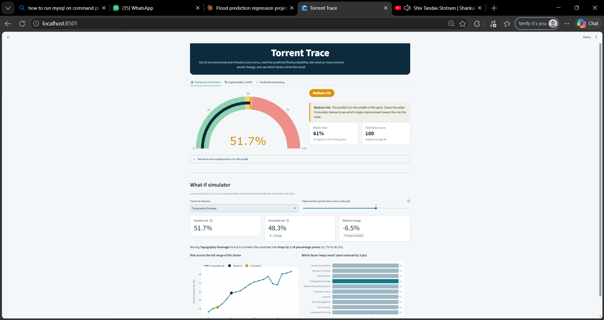
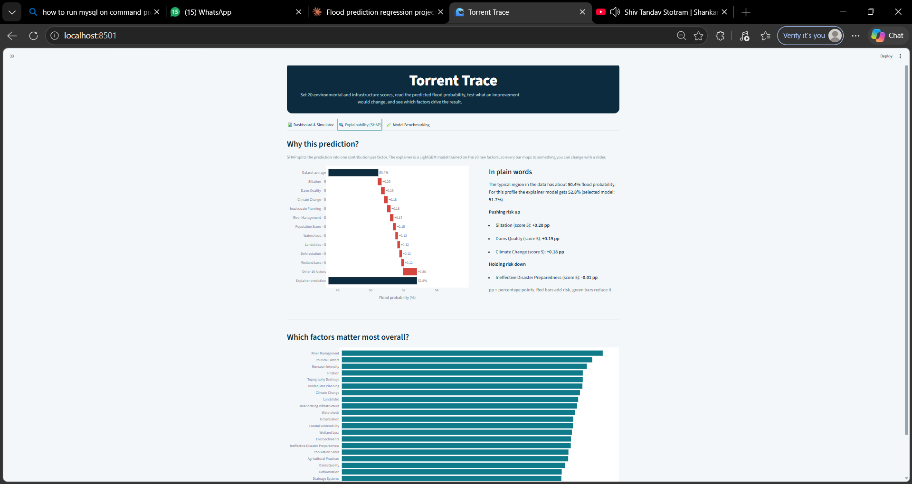

# 🌊 Torrent Trace

**See the flood risk. Trace the cause. Test the fix.**

Torrent Trace turns 20 environmental and infrastructure scores into a flood probability, explains *why* the model produced it, and lets you test what an improvement would change. It is built on the Kaggle Playground Series S4E5 dataset, *Regression with a Flood Prediction Dataset*.

> **Live demo:** https://torrent-trace.streamlit.app/



---

## Features

| Tab | What it does |
|---|---|
| 📊 **Dashboard & Simulator** | Color-coded gauge (Low / Medium / High), alert banner, and a what-if simulator that compares baseline vs. simulated risk. Also shows a sensitivity curve and a ranking of which factor reduces risk the most. |
| 🔍 **Explainability (SHAP)** | Interactive waterfall chart showing which factors push risk up or down for the current inputs, a plain-language summary, and global factor importance. |
| 🧪 **Model Benchmarking** | Test-set R² / RMSE / MAE for six models, learned ensemble weights, and a feature-engineering ablation study. |

Also included: 20 grouped sliders, preset profiles (Typical, Safer, Riskier, Random real row), and a model selector.

## Screenshots

| Dashboard | SHAP | Benchmarking |
|---|---|---|
|  |  |  |

## How it works

```
flood-prediction.zip
        │
        ▼
  train.py ──► unzip + load (memory-optimised)
        │      split 70 / 15 / 15  (train / validation / test)
        │      feature engineering (row-wise sum, mean, std, min, max, skew)
        │      ablation study (Ridge + LightGBM)
        │      train Linear, Ridge, LightGBM, XGBoost, CatBoost
        │      learn ensemble weights on validation (SLSQP, w ≥ 0, Σw = 1)
        ▼
  saved_models/  (joblib models + metadata.json)
        │
        ▼
  app.py (Streamlit) ──► gauge · what-if · SHAP · benchmarking
```

**Key ideas**
- The target is almost a linear function of the total factor score, so Ridge is a very strong baseline. Row-wise statistics help tree models the most.
- Risk tiers are **relative**: Low, Medium and High are the bottom, middle and top third of the training data.
- SHAP uses a LightGBM model trained on the 20 raw factors, so every bar corresponds to a slider.
- `train.py` and `app.py` share one `engineer_features` function, so there is no train/serve mismatch.

## Results

Scores are measured on a held-out test split. *(Replace with your own numbers after running `python train.py`.)*

| Model | R² | RMSE |
|---|---|---|
| Linear Regression | 0.8450|  0.02007|
| Ridge Regression |  0.8450 | 0.02007  |
| LightGBM | 0.8685 |  0.01849 |
| XGBoost | 0.8685 | 0.01849 |
| CatBoost |  0.8684 | 0.01850 |
| Weighted Ensemble | 0.8645 | 0.01877  |

## Tech stack

- **Language:** Python 3.10+
- **Data:** pandas, NumPy, SciPy
- **Models:** scikit-learn, LightGBM, XGBoost, CatBoost
- **Explainability:** SHAP
- **UI:** Streamlit, Plotly
- **Persistence:** joblib

## Project structure

```
torrent-trace/
├── app.py                 # Streamlit web app
├── train.py               # data pipeline, ablation, training, saving
├── requirements.txt
├── saved_models/          # trained models + metadata.json
├── screenshots/           # images used in this README
├── .streamlit/
│   └── config.toml        # theme
└── README.md
```

## Getting started

```bash
# 1. Clone
git clone <your-repo-url>
cd torrent-trace

# 2. Create a virtual environment
python -m venv venv
venv\Scripts\activate            # Windows
# source venv/bin/activate       # macOS / Linux

# 3. Install dependencies
python -m pip install -r requirements.txt

# 4. Run the app (uses the models already in saved_models/)
python -m streamlit run app.py
```

### Retrain the models (optional)

The Kaggle data is not included in this repository. Download it from the
[competition page](https://www.kaggle.com/competitions/playground-series-s4e5/data),
save it as `flood-prediction.zip` in the project folder, then run:

```bash
python train.py --fast          # quick test run
python train.py                 # full run
```

Other options: `--sample 300000` (use a subset of rows), `--zip <path>` (custom zip location).

## Limitations

- The dataset is **synthetic** (generated from a real flood-factors dataset), so this is a learning and demonstration tool, not an early-warning system.
- Risk tiers are relative to this dataset, not absolute physical thresholds.
- SHAP explains what the model relies on. It does not prove cause and effect.
- The data contains no location information, so the app predicts for a described profile, not a named place.

## Future work

- Map view of regional risk (state or district level)
- Downloadable PDF report for a given profile
- Batch prediction from an uploaded CSV
- Integration of real rainfall and flood records (e.g., IMD, NDMA)

## Acknowledgements

- Dataset: Kaggle Playground Series S4E5, *Regression with a Flood Prediction Dataset*
- Original source data: *Flood Prediction Factors* dataset on Kaggle

## Author

**`Gauranshi Lavania`** · `IET Lucknow / CSE`  · [GitHub](https://github.com/Gauranshi-Lavania)

## License

This project is licensed under the MIT License. See the [LICENSE](LICENSE) file for details.